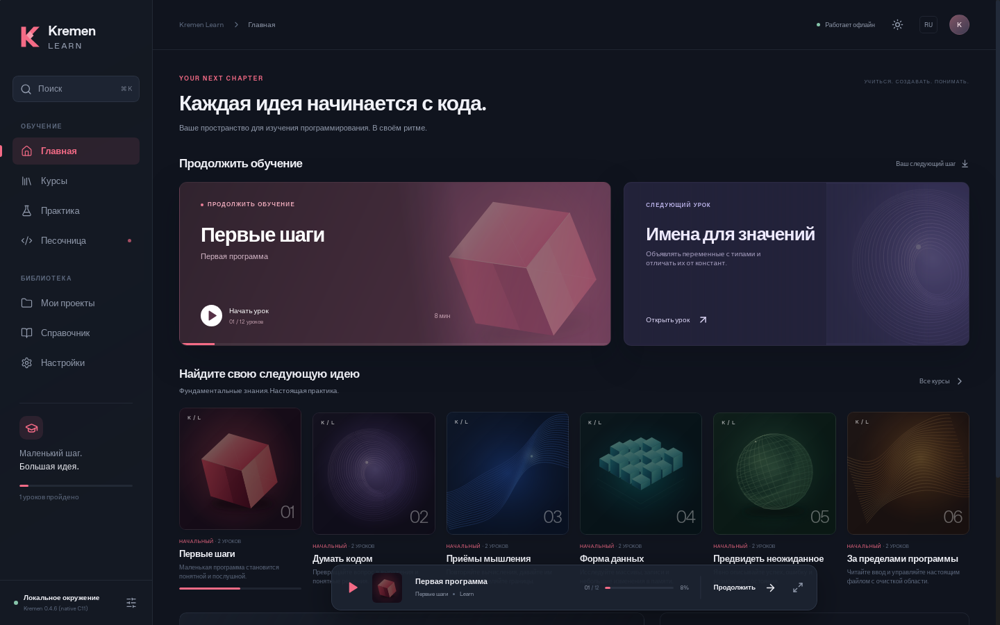
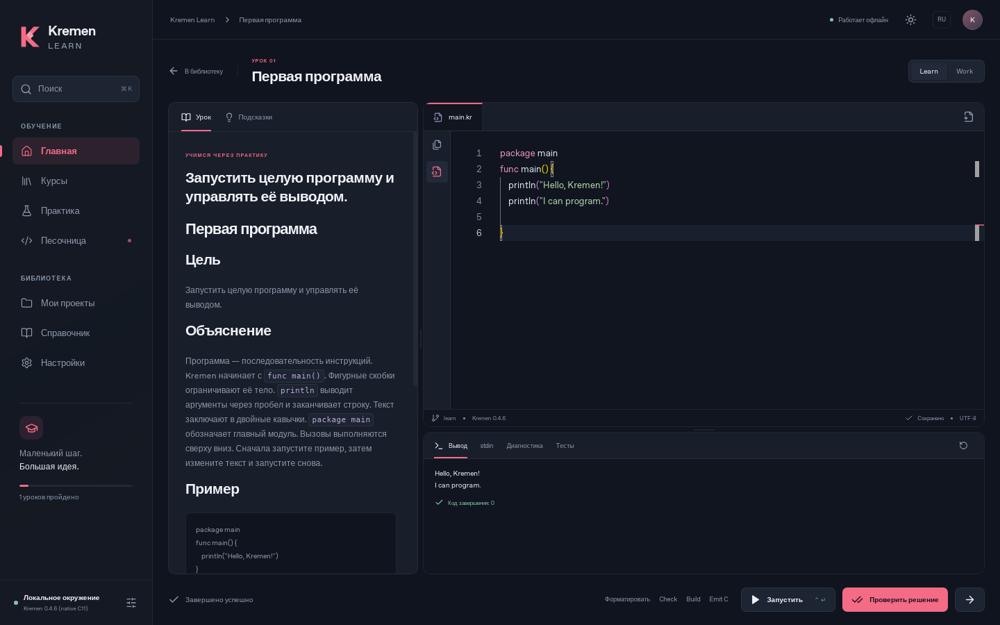

# Kremen Learn

[Русский](README.ru.md) · [Getting started](#getting-started) · [Development](docs/DEVELOPMENT.md) · [Roadmap](ROADMAP.md)

Learn Kremen by writing real programs. Follow a short lesson, change the code,
run it on your computer, and see what happens. When you want to try an idea of
your own, open a project in the same editor.

Kremen Learn is a free, open-source desktop application. Lessons, the editor
and the compiler work locally. There are no accounts, subscriptions or servers.



## What you can do

- Work through **12 beginner lessons**, from your first program to error
  handling and resource cleanup. Each has an example, a task, tests, hints
  and a solution explained in Russian and English.
- Write `.kr` and `.krh` files in Monaco, use search and replace, format code
  with Kremen, and jump from a compiler error to the relevant code.
- Run actual `check`, build/run, `emit-c`, `fmt` and `explain` commands.
  Work and Learn use the compiler's real `--mode=work|learn` flags.
- Create and open local projects, use local imports, and export your work.
  Progress and the active editor session are stored locally in SQLite.
- Choose a dark or light theme, switch the interface language, adjust its
  scale, use keyboard shortcuts, or reduce animation.

The editor uses keyword suggestions; a semantic language server is not included.
The file sidebar currently shows relative paths as a flat list.

## Platform status

Version **0.1.0** is an early, working Linux release.

| Platform | Current state |
| --- | --- |
| Debian 13, x86-64 | Built and run; the custom `.run` installer was installed and tested. A `.deb` was built and inspected. |
| Other Linux distributions | Not verified. Older glibc versions may require a rebuild. |
| Windows | Native compiler integration, isolation and an `.exe` installer are unfinished. Optional WSL2/WSLg scripts have not been tested on Windows. |

See [platform details](docs/PLATFORMS.md) before choosing a package.

## Getting started

The Linux packages are distributed separately from the source tree. The custom
installer contains the application, Kremen, its runtime header, lessons and
course artwork. If you have the `.run` package:

```sh
chmod +x Kremen-Learn-0.1.0-linux-x86_64.run
./Kremen-Learn-0.1.0-linux-x86_64.run --help
./Kremen-Learn-0.1.0-linux-x86_64.run
```

Your system must already provide **WebKitGTK 4.1, GTK 3, GCC, libc development
headers, pthread and Bubblewrap with working user namespaces**. The installer
checks dependencies; it does not download them. Once these packages are
available, installation and learning can happen offline. See the
[installation guide](installer/README.md) for custom locations and removal.

To try the first lesson:

1. Open Settings and check that the toolchain is ready.
2. Choose a course and open its first lesson.
3. Edit the code and press **Ctrl+Enter** to run it.
4. Use **Check solution**. Passing the actual tests saves completion.

For your own code, choose **My projects → Open by path** and enter the absolute
path of a local Kremen project. A system folder chooser is also available.
**Ctrl+S** saves project files. Save those edits before switching to a lesson;
the active editor session and files on disk are separate.



## Build it yourself

The application uses Rust and Tauri 2, a statically exported Next.js interface
with React and TypeScript, and a C++ installer. The original Kremen compiler
is C11. The installed app needs no Node.js or Next.js server.

Install the system dependencies and toolchains from the
[development guide](docs/DEVELOPMENT.md), then run:

```sh
npm ci
sh scripts/build-toolchain.sh
npm run verify:lessons
npm run desktop
```

Create the Linux packages with:

```sh
npm run package -- --bundles deb
bash scripts/build-installer.sh
```

The browser preview is useful for interface work. Compilation and native file
operations require the desktop window; the preview reports that requirement.

## The compiler and the checks

Kremen is pinned to **0.4.6**, commit
[`671140c`](https://github.com/nullmonori-sopp/Kremen/commit/671140cd1ef4ea453a07047df07c945efa7184e2).
Its source is included in `vendor/kremen/`; builds do not follow a moving branch.
Kremen generates C and uses the system C compiler as its backend.

The recorded checks include 120 upstream compiler checks, 13 native application
tests, 16 lesson solution cases and eight installer scenarios. The
[verification report](docs/VERIFICATION.md) contains the evidence, screenshots,
environment details and remaining gaps. A workflow is included; these local
results do not claim a successful GitHub Actions run.

User programs run in temporary directories through Linux Bubblewrap namespaces,
with process stopping and resource limits. These limits apply per process;
there is no aggregate memory or disk quota. Read the
[execution model](docs/EXECUTION.md) before running unfamiliar code.

## Help shape the next version

Windows support, more complete project sessions and the next set of lessons
are on the [roadmap](ROADMAP.md). Bug reports, clearer explanations,
translations and code fixes are welcome. You can write in Russian or English.
The [contribution guide](CONTRIBUTING.md) explains where to start.

More about the project:
[architecture](docs/ARCHITECTURE.md) ·
[lesson format](docs/LESSON-FORMAT.md) ·
[compiler audit](docs/COMPILER-AUDIT.md) ·
[changelog](CHANGELOG.md).

Kremen Learn is released under the [MIT license](LICENSE). The compiler retains
its own MIT notice; other dependencies are listed in
[third-party notices](THIRD-PARTY-NOTICES.md).
