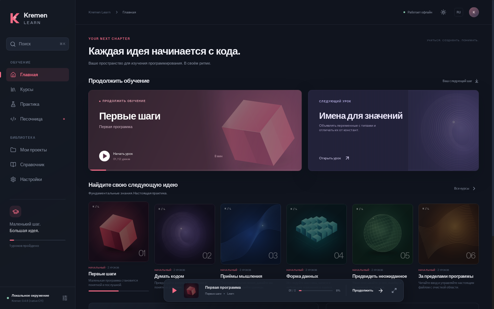

# Kremen Learn

[English](README.md) · [Архитектура](docs/ARCHITECTURE.ru.md) · [Аудит компилятора](docs/COMPILER-AUDIT.ru.md)

Открытая настольная среда изучения программирования на Kremen: библиотека
курсов, редактор, настоящий локальный компилятор, упражнения и собственные
проекты. Работает офлайн, без регистрации, сервера и подписки.

Первая версия предназначена для **Linux x86-64**. Поддержка Windows не завершена;
проверенного установщика Windows нет. См. [состояние платформ](docs/PLATFORMS.ru.md).



## Установка

Собственный установщик на C++: `artifacts/Kremen-Learn-0.1.0-linux-x86_64.run`.
Он содержит приложение, компилятор, runtime, уроки и оригинальные обложки.
Бинарные пакеты передаются отдельно и не включаются в Git. Из исходников они
создаются командами сборки ниже.

```sh
chmod +x Kremen-Learn-0.1.0-linux-x86_64.run
./Kremen-Learn-0.1.0-linux-x86_64.run --help
./Kremen-Learn-0.1.0-linux-x86_64.run
```

Выбор каталога и удаление описаны в [инструкции установщика](installer/README.ru.md).
Debian-пакет собирается в `src-tauri/target/release/bundle/deb/`.

Система должна предоставлять **WebKitGTK 4.1, GTK 3, GCC с заголовками libc и
pthread, Bubblewrap с разрешёнными пользовательскими пространствами имён**.
После подготовки системных пакетов установка возможна без сети. Установщик
проверяет зависимости и не загружает их самостоятельно. Само приложение не
выполняет сетевых запросов.

## Возможности

- Тёмная и светлая темы, русский и английский интерфейс, управление клавиатурой,
  видимый фокус, уменьшение анимации и масштабирование.
- Двенадцать начальных уроков: отдельный Markdown на двух языках, метаданные,
  примеры, стартовый код, точные тесты и последовательные подсказки.
- Локальный Monaco, файлы `.kr` / `.krh`, вкладки и дерево проекта, поиск и замена,
  форматирование компилятором, JSON-диагностика и объяснения ошибок.
- Настоящие `check`, build/run, `emit-c`, `fmt`, `explain`, `--mode=work|learn`.
- SQLite для прогресса и сессии, локальные проекты, экспорт, импорт и резервирование.
- Отдельные временные каталоги, лимиты ресурсов и остановка дерева процессов.

Используется Kremen **0.4.6**, коммит
`671140cd1ef4ea453a07047df07c945efa7184e2`. Оригинальный MIT-код включён в
`vendor/kremen/`. Kremen генерирует C, поэтому для сборки программ нужен внешний
C-компилятор. Семантическое автодополнение не заявляется; доступны ключевые слова.

## Разработка и сборка

См. [инструкцию разработки](docs/DEVELOPMENT.ru.md). Интерфейс: Next.js со
статическим экспортом, React, TypeScript и Monaco. Нативная часть: Rust/Tauri 2.
Собственный установщик: C++. Инструменты сборки: JavaScript, Python и shell.
Оригинальный компилятор Kremen написан на C11.

```sh
npm ci
sh scripts/build-toolchain.sh
python3 scripts/verify-lessons.py
npm run build
cargo test --manifest-path src-tauri/Cargo.toml --lib -- --include-ignored --test-threads=1
npm run desktop
npm run package -- --bundles deb
bash scripts/build-installer.sh
```

Браузерный предпросмотр показывает интерфейс. Для компиляции и работы с файлами
требуется настольное приложение; предпросмотр не имитирует успешные запуски,
проверки и сохранение.

## Первый запуск

В настройках проверьте готовность настоящего тулчейна. Выберите курс и первый
урок, измените код, нажмите Ctrl+Enter, затем «Проверить решение». Завершение
записывается после прохождения настоящих тестов.

Для свободной разработки выберите «Мои проекты → Открыть по пути» и укажите
абсолютный путь к каталогу с `.kr`-программой. Доступен и системный диалог папок.
Недавние проекты перечитываются с диска. Ctrl+S сохраняет файлы проекта,
активная сессия редактора сохраняется отдельно. Перед переходом к урокам
сохраните изменения проекта на диск.

## Границы

[Модель запуска](docs/EXECUTION.ru.md) объясняет изоляцию. Лимиты времени и памяти
сами по себе не ограничивают доступ к файлам. Linux-запуск требует Bubblewrap;
при недоступности изоляции приложение сообщает ошибку. Это учебный инструмент,
а не защита от уязвимостей ядра. Локальные тесты доступны для просмотра.

[Проверки и ограничения](docs/VERIFICATION.ru.md) фиксируют фактические результаты.
Лицензия MIT; [сторонние компоненты](THIRD-PARTY-NOTICES.ru.md).
