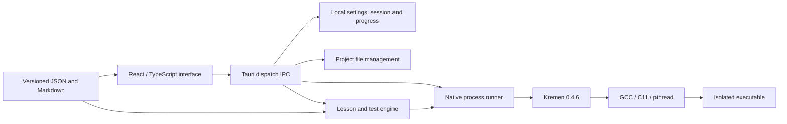

# Architecture

Kremen Learn is a local desktop application. Next.js produces a static export;
Tauri embeds that export in the desktop executable. The installed application
does not run a Next.js server, connect to an account service or fetch lessons
from a remote API. Development dependencies are downloaded during the build,
not while taking a lesson.

## Boundaries

* `app/` is the Next.js entry point. The client application lives in `src/`.
  React manages navigation, course presentation, the lesson workspace, settings
  and project editing. Motion handles interface transitions. CSS tokens define
  themes and shared spacing.
* `src/bridge.ts` is the desktop boundary. It calls the Rust `dispatch` command
  with a JSON request whose `action` selects an operation. In a browser preview
  it reports that the desktop runtime is required; it does not emulate a
  successful compilation or file write.
* `src/monaco.ts` registers Kremen's lexical syntax and editor behavior. Monaco
  and its worker are packaged locally. Keyword assistance is not a semantic
  language server.
* `src-tauri/src/` owns filesystem access, process execution, diagnostics,
  lesson verification and SQLite-backed state. Work that can block runs outside
  the UI thread. User source text is not assembled into a shell command.
  `engine.rs` coordinates IPC operations and lesson tests; `storage.rs` owns
  local state; `process.rs` owns staging, isolation and process lifecycle;
  `diagnostics.rs` converts real compiler source ranges into editor positions.
* `content/catalog.json` and `content/lessons/` hold the curriculum independently
  of presentation code. `scripts/sync-content.mjs` copies it into the static UI
  assets; Tauri also packages it as native resources for verification.
* `installer/installer.cpp` implements the C++ per-user Linux installer. The
  JavaScript and shell files in `scripts/` are build and development tools.

The UI sends complete source snapshots (`files`, `entry`, mode and standard
input) when starting an operation. Native code treats project names and paths
as data and constructs process arguments individually. Compiler results and
exercise results return through IPC; the interface derives status from those
results instead of assuming that clicking Run succeeded.

## Compiler contract

The compiler is pinned by `toolchain.lock.json` to Kremen 0.4.6, commit
`671140cd1ef4ea453a07047df07c945efa7184e2`. Its executable and runtime header are
separate native resources. It translates source into C and requires a working
C11 backend with pthread support to build programs. GCC is a system dependency
of the Linux package.

The adapter uses real `check`, `build`, `emit-c`, `fmt` and `explain` commands.
Running a program involves building an executable and then executing it under
the runner's limits. `--mode=work` or `--mode=learn` is passed to commands that
accept it. `fmt` and `explain` do not accept a mode flag. Learn adds the
compiler's learning requirements; shared safety checks remain enabled in both
modes. Application preferences are not presented as a compiler project-profile
file.

`--diagnostic-format=json` supplies frontend diagnostics. Kremen's offsets and
columns refer to UTF-8 bytes; Monaco columns count UTF-16 code units. The native
adapter converts positions against the original source, preserving tabs as
one source character and counting supplementary Unicode characters correctly.
The original diagnostic message remains available. C compiler and runtime
messages may be plain stderr and must not be interpreted as Kremen JSON.

## Persistence and project ownership

Progress, settings and the editing session are local data. Course source
snapshots and free projects are separate from the bundled lesson definitions.
An unsuccessful test does not erase an earlier completed lesson. Export and
import transfer local progress; a backup is an explicit file operation rather
than a cloud synchronization feature.

The custom installer owns only its marked release directory and launchers
under the selected prefix. Application data and user-selected project folders
are separate. Uninstalling the program preserves those data. The installer
keeps old binary releases until uninstall; that is not a backup mechanism for
projects or progress.

## Execution and platform limits

Read [the execution model](EXECUTION.md) for the actual isolation boundary,
limits and failure behavior. Resource limits and access restrictions are
different mechanisms. A timeout alone does not prevent filesystem or network
access.

The upstream compiler is POSIX-based. A native Windows compiler port and a
Windows/WSL runner are not implied by the cross-platform UI framework. Platform
verification and remaining limitations belong in the release verification
report. The C++ installer described here is specifically for Linux x86-64.
