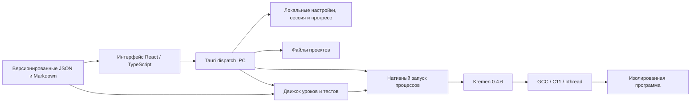

# Архитектура

Kremen Learn — локальное настольное приложение. Next.js создаёт статический
экспорт, который Tauri включает в настольную программу. Установленная программа
не запускает сервер Next.js, не обращается к службе учётных записей и не
скачивает уроки через удалённый API. Зависимости разработки загружаются при
сборке, а не во время занятий.

## Границы компонентов

* `app/` содержит точку входа Next.js; клиентское приложение находится в `src/`.
  React управляет навигацией, библиотекой курсов, рабочим пространством урока,
  настройками и редактором проектов. Motion отвечает за переходы интерфейса.
  Общие CSS-токены задают темы и размеры.
* `src/bridge.ts` — граница настольной среды. Он вызывает Rust-команду
  `dispatch`, передавая JSON-запрос с полем `action`. В браузерном предпросмотре
  мост сообщает, что нужна настольная программа; успешная компиляция или запись
  файла не имитируется.
* `src/monaco.ts` регистрирует лексическую подсветку Kremen и поведение
  редактора. Monaco и его worker включаются в локальный комплект. Подсказки
  ключевых слов не являются семантическим языковым сервером.
* `src-tauri/src/` отвечает за файловую систему, процессы, диагностику,
  проверку упражнений и локальное состояние в SQLite. Блокирующая работа
  выполняется вне потока интерфейса. Пользовательский код не подставляется
  в строку команды оболочки.
  `engine.rs` объединяет IPC-операции и тесты уроков; `storage.rs` отвечает
  за локальные данные; `process.rs` — за временные файлы, изоляцию и жизнь
  процессов; `diagnostics.rs` переводит настоящие позиции ошибок в координаты
  редактора.
* `content/catalog.json` и `content/lessons/` хранят учебное содержание отдельно
  от интерфейса. `scripts/sync-content.mjs` копирует его в статические ресурсы;
  Tauri также включает эти файлы в нативные ресурсы для проверки решений.
* `installer/installer.cpp` — собственный пользовательский установщик для
  Linux на C++. JavaScript и shell-скрипты в `scripts/` служат для сборки
  и разработки.

При запуске операции интерфейс передаёт полный снимок исходников: `files`,
`entry`, режим и стандартный ввод. Нативная часть воспринимает имена проектов
и пути как данные и передаёт аргументы процессам отдельно. Результаты
компилятора и проверки возвращаются через IPC; статусы интерфейса выводятся
из настоящих результатов, а не из самого нажатия кнопки.

## Контракт компилятора

Файл `toolchain.lock.json` фиксирует Kremen 0.4.6 и коммит
`671140cd1ef4ea453a07047df07c945efa7184e2`. Исполняемый файл компилятора и
заголовок runtime — отдельные нативные ресурсы. Kremen преобразует программу
в C; для сборки нужен работающий C11-компилятор с pthread. GCC — системная
зависимость Linux-пакета.

Адаптер вызывает настоящие `check`, `build`, `emit-c`, `fmt` и `explain`.
Для запуска сначала создаётся исполняемый файл, затем он выполняется с
ограничениями движка. Флаг `--mode=work` или `--mode=learn` передаётся только
командам, которые его поддерживают. `fmt` и `explain` не принимают режим.
Learn добавляет учебные требования компилятора; общие проверки безопасности
включены в обоих режимах. Настройки приложения не выдаются за файл профиля
проекта компилятора.

Флаг `--diagnostic-format=json` возвращает диагностику frontend компилятора.
Смещения и колонки Kremen измеряются байтами UTF-8; колонки Monaco — кодовыми
единицами UTF-16. Нативный адаптер преобразует позиции по исходному тексту:
табуляция остаётся одним символом исходника, дополнительные Unicode-символы
учитываются корректно. Исходное сообщение ошибки сохраняется. Сообщения
C-компилятора и запущенной программы могут быть обычным stderr и не должны
обрабатываться как JSON Kremen.

## Данные и проекты

Прогресс, настройки и сессия редактирования хранятся локально. Снимки кода
уроков и свободные проекты отделены от встроенных определений уроков.
Неудачная проверка не удаляет уже завершённый урок. Экспорт и импорт переносят
локальный прогресс; резервная копия — явная файловая операция, а не облачная
синхронизация.

Собственному установщику принадлежат только помеченный каталог выпусков и
команды запуска в выбранном префиксе. Данные программы и выбранные пользователем
папки проектов расположены отдельно. Удаление приложения сохраняет эти данные.
Установщик хранит старые двоичные выпуски до удаления; это не механизм
резервного копирования прогресса и проектов.

## Запуск и платформенные ограничения

Фактические границы изоляции, лимиты и поведение при отказе описаны в
[модели запуска](EXECUTION.ru.md). Ограничение ресурсов и ограничение доступа —
разные механизмы. Один таймаут не запрещает доступ к файлам или сети.

Исходный компилятор использует POSIX. Кроссплатформенный интерфейс сам по себе
не означает готовый нативный порт компилятора или проверенный Windows/WSL-движок.
Проверки платформ и оставшиеся ограничения указываются в отчёте о выпуске.
Описанный здесь установщик на C++ предназначен для Linux x86-64.
